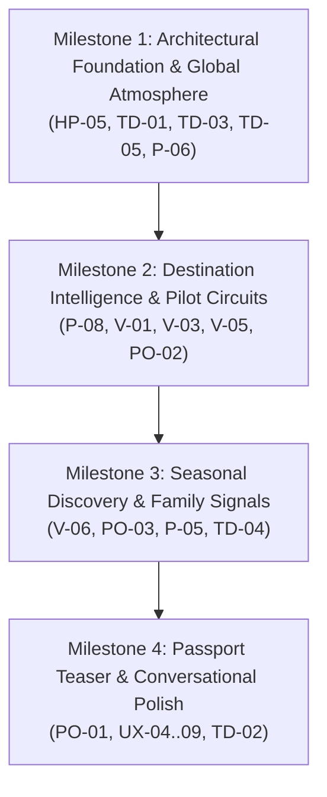

# Search My Vacation (SMV) — Release 1.4 Kickoff & Handoff Packet

**Authoritative Baseline:** Release 1.3 tagged `v1.3.0` at commit `7ab233b` (`main` and `release/r1.3` in sync)  
**Live Production URL:** `https://searchmyvacation.com`  
**Product Owner:** Vivek Renganathan  
**Target Release:** Release 1.4 — Destination Intelligence, Trip Anchors, Passport Experience & Site-Wide Soundscape  
**Total Backlog Items:** 22 (13 High, 8 Medium, 1 Low)  
**Approved Tracker Files:**  
- `docs/10-Backlog/SMV_R1.4_Release_Plan.md`  
- `SMV_Release_Charter_Approved/SMV_R1.4_Release_Plan_APPROVED.xlsx`  
- `SMV_Release_Charter_Approved/SMV_Master_Release_Charter_R1.3_to_R1.7_and_CRM_APPROVED.xlsx`

---

## 1. Project Context & Architectural Invariants

### A. Tech Stack & Infrastructure
- **Framework:** Next.js 16.2.10 (App Router), React 19, Tailwind CSS v4, TypeScript 5.
- **Environments:**
  - **Local Dev / Preview:** Supabase `SMV-preprod` (`pkfdunyeaqdvvklutgon`)
  - **Production:** Supabase `SearchMyVacation_WebsiteUpgrade` (`jbsefolhlfkplawiuvlu`)
  - **Hosting:** Vercel Pro (`search-my-vacation`, project `prj_FT0mYYyrbhGNnDQUp8qLw8PrHHm5`)
- **Release Safety Guardrail:** `web/vercel.json` sets `git.deploymentEnabled.main = false`. Pushing to `main` does NOT auto-deploy. Production releases must follow the manual, staged operator runbook (`vercel deploy --prod --skip-domain` followed by `vercel promote`).
- **Pre-Prod Isolation:** Never run migrations or customer test traffic against Production until explicitly approved by Vivek during final promotion.

### B. Baseline Verification Suite (223/223 Checks Passing)
Before writing any R1.4 code, verify the clean baseline:
```bash
npm --prefix web run verify:milestone-1
npm --prefix web run verify:milestone-2
npm --prefix web run verify:milestone-3
npm --prefix web run verify:milestone-4
```

---

## 2. Release 1.4 Complete Backlog Scope (22 Items)

| ID | Area | Title | Priority | Disposition | Key Objective |
| :--- | :--- | :--- | :---: | :---: | :--- |
| **`HP-05`** | Atmosphere | Site-Wide Ambient Soundscape & Mute/Unmute | **High** | New (PO) | RootLayout audio persistence, Mute/Unmute cross-fade, discovery beacon, iOS silent switch bypass |
| **`TD-01`** | Engineering | Journey Passport Modularization | **High** | Keep | Refactor Passport wizard, steps, and OTP hooks into modular, testable components |
| **`TD-02`** | Engineering | Automated Passport & OTP Regression Suite | **High** | Keep | Automated E2E/integration tests using cost-free OTP test doubles |
| **`TD-03`** | Engineering | Centralize Mobile Normalization & Docs | Medium | Keep | Single shared E.164 utility across client & server; document formats |
| **`TD-04`** | Operations | OTP Provider Error Classification | Medium | Keep | Distinguish timeout, config, and rejection errors with PII-safe messaging |
| **`TD-05`** | Engineering | Standardize Passport Validation Rules | Medium | Keep | Harmonize name and field validation schemas across initial and edit screens |
| **`P-08`** | Intelligence | Weighted Destination Model Runtime | **High** | Keep | Primary/Secondary/Tertiary Journey & Memory preference scoring alignment |
| **`V-01`** | Intelligence | Region-Level Destination Intelligence | **High** | Keep | Expand flat states into named regions & pilot circuits (Himachal/Uttarakhand & Kerala/Tamil Nadu) |
| **`V-03`** | Intelligence | Companion Destinations | Medium | Keep | Editorial pairing rules suggesting 2–3 complementary destinations |
| **`V-05`** | Intelligence | Regional Journey Recommendations | Medium | Keep | Enable engine to output region-level circuits matching traveler mood |
| **`PO-02`** | Discovery | Consultative 'Trip Anchors' on Cards | **High** | New (PO) | Indicative Duration, Best Months, Pace, and Investment Tiers without rigid pricing |
| **`V-06`** | Discovery | Traveller Inspiration & Seasonal Discovery | Medium | Keep | Travel by Month / Season window filters and visa lead-time cues |
| **`PO-03`** | Discovery | Family Comfort Signals | **High** | New (PO) | Senior-Friendly, Kid-Easy, Pure Veg/Jain Food Ready, First International Trip tags |
| **`P-05`** | AI / Context | Free-Text Intent & Theme Enrichment | Medium | Keep | Extract structured themes from getaway description downstream of deterministic scoring |
| **`PO-01`** | Conversion | Journey Synopsis Teaser & Preview Mode | **High** | New (PO) | Sample synopsis on homepage + partially unlocked teaser prior to OTP |
| **`UX-04`** | Passport UX | Cross-Step Intent Synchronization | **High** | Keep | Earlier selections reflect as non-binding suggestions in later steps |
| **`UX-05`** | Passport UX | Pending Suggestion Chip for Destinations | **High** | Keep | Destination cards link to Passport with interactive pending chip (Keep / Not quite) |
| **`UX-06`** | Passport UX | Auto-Growing Getaway Textarea | **High** | Keep | Free-text field auto-expands up to ~8 rows without layout jump |
| **`UX-07`** | Passport UX | Near-Limit Character Counter | **High** | Keep | Subtle accessible counter appears only when approaching 500-char limit |
| **`UX-08`** | Passport UX | Passport Stamp Timing vs OTP Activation | **High** | Keep | Visual completion stamp upon finishing questions; OTP gates full synopsis |
| **`UX-09`** | Passport UX | Companion Card Selection Styling | Low | Keep | Active highlight styling strictly on selected companion card |
| **`P-06`** | Design | Design Token Reconciliation | Medium | Keep | Reconcile spacing, typography, and color tokens across Homepage & Passport |

---

## 3. Recommended 4-Milestone Phased Roadmap



### Milestone 1: Architectural Foundation & Global Atmosphere (5 Items)
- **Scope:** `HP-05` (Global Soundscape & Mute/Unmute), `TD-01` (Passport Modularization), `TD-03` (Shared E.164 Normalization), `TD-05` (Validation Standardization), `P-06` (Token Reconciliation).
- **Target Branch:** `feature/r1.4-milestone-1-foundation-soundscape`

### Milestone 2: Destination Intelligence & Consultative Trip Anchors (5 Items)
- **Scope:** `P-08` (Weighted Runtime Model), `V-01` (Region Pilot Circuits), `V-03` (Companion Destinations), `V-05` (Regional Journey Output), `PO-02` (Consultative Trip Anchors on Cards).
- **Target Branch:** `feature/r1.4-milestone-2-destination-intelligence`

### Milestone 3: Seasonal Discovery, Comfort Signals & Theme Enrichment (4 Items)
- **Scope:** `V-06` (Travel by Month / Window), `PO-03` (Family & Dietary Comfort Signals), `P-05` (Free-Text Enrichment), `TD-04` (OTP Error Classification).
- **Target Branch:** `feature/r1.4-milestone-3-discovery-comfort-signals`

### Milestone 4: Teaser Mode, Passport Experience & Automated Testing (8 Items)
- **Scope:** `PO-01` (Synopsis Teaser Mode), `UX-04` (Intent Sync), `UX-05` (Pending Destination Chips), `UX-06` (Auto-Growing Textarea), `UX-07` (Character Counter), `UX-08` (Completion Stamp), `UX-09` (Companion Styling), `TD-02` (Automated E2E/Integration Suite).
- **Target Branch:** `feature/r1.4-milestone-4-passport-teaser-polish`

---

## 4. Specific Focus: HP-05 Implementation Guidance
When implementing `HP-05`:
1. **Mounting:** Create `<AmbientAudioProvider>` wrapping `{children}` in `web/app/layout.tsx`.
2. **Audio Element:** Single `<audio loop src="/audio/smv-ambient-journey.mp3" preload="metadata" />` mounted at root layout level so route transitions never unmount or restart it.
3. **Mute/Unmute Cross-Fade:** Use HTML5 volume animation interval or Web Audio API GainNode to ramp volume between `0.0` and `0.28` over 800ms.
4. **First-Time Discovery Beacon:** If `localStorage.getItem("smv_soundscape_visited")` is null, render gentle gold pulsing ring on the bottom-left pill + polite 7-second auto-dismissing tooltip: *"Experience with sound · Tap to unmute"*.
5. **Cross-Device Parity:**
   - Desktop/Tablet: Expanded luxury pill with track name, soundwaves, and mute toggle.
   - Mobile: Compact medallion anchored at `bottom-5 left-4` with `env(safe-area-inset-bottom)` and dynamic offset away from Passport sticky bottom action bars.
6. **Mobile Audio Lifecycle:**
   - Unmute tap serves as direct user interaction, unlocking iOS Safari silent switch.
   - Attach `document.addEventListener("visibilitychange", ...)` to duck/pause audio when tab is backgrounded and fade back up upon return.
