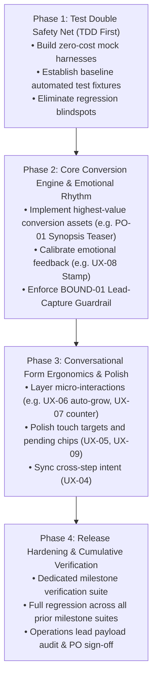

# Search My Vacation (SMV) — Release Lifecycle & Milestone Execution SOP

**Authoritative Standard Operating Procedure (SOP)**  
**Governing Document:** Approved by Product Owner (Vivek Renganathan) on Release 1.4 Milestone 4 Kickoff  
**Applicability:** All current and future releases (Release 1.4, 1.5, 1.6, 1.7+, and CRM)

---

## 1. Branching Strategy & Lifecycle Hierarchy

To ensure uninterrupted production stability, zero trunk drift, and auditable governance, all releases must adhere to the following 4-tier branching hierarchy:

```
main (Production Trunk - strictly protected)
  ▲
  └── release/rX.Y (Umbrella Release Branch)
        ▲
        ├── feature/rX.Y-milestone-1-... (Milestone 1 Branch)
        ├── feature/rX.Y-milestone-2-... (Milestone 2 Branch)
        ├── feature/rX.Y-milestone-3-... (Milestone 3 Branch)
        └── feature/rX.Y-milestone-4-... (Milestone 4 Branch)
```

### Mandatory Branching Rules
1. **Baseline Synchronization:** Before initiating a new release, `main` and the preceding release branch (e.g. `release/r1.3`) must be verified in sync at the identical commit SHA.
2. **Umbrella Branch:** A dedicated `release/rX.Y` branch is created from `main`. Direct commits to `release/rX.Y` are prohibited except for non-fast-forward milestone merges (`git merge --no-ff`).
3. **Milestone Branches:** Each milestone branch (`feature/rX.Y-milestone-N-...`) is branched from `release/rX.Y`.
4. **Approval Gate Before Code:** No implementation or feature branch development may commence until the Product Owner (Vivek) reviews and formally signs off on the Milestone Approach Plan.
5. **No Fast-Forward Merges:** When a milestone passes 100% verification, it is merged into `release/rX.Y` using `git merge --no-ff` to preserve milestone encapsulation and git history.
6. **Final Trunk Promotion:** Only after all planned milestones are merged into `release/rX.Y` and full staging/pre-prod regression passes is `release/rX.Y` merged into `main` and tagged (e.g. `v1.4.0`).
7. **Production Deployment Guardrail:** `web/vercel.json` keeps `git.deploymentEnabled.main = false`. Production releases are executed via the staged manual deployment runbook (`vercel deploy --prod --skip-domain` followed by `vercel promote`).

---

## 2. Milestone Execution Sequencing SOP: "Test-Harness First & Conversion Core"

When planning and executing any multi-item milestone—especially those touching customer conversion, authentication, or multi-step form journeys—teams must strictly follow the **"Test-Harness First & Conversion-Core"** execution order:



### The 4 Execution Phases

#### Phase 1: Test-Harness & Safety Net First (TDD First)
- **Objective:** Never modify sensitive production components (such as `JourneyPassport.tsx` or OTP flows) without an automated test safety net.
- **Rule:** Construct test doubles and deterministic mock fixtures first (e.g. `TD-02`).
- **Cost Invariant:** Guarantees zero live SMS provider charges ($0.00) during CI and automated testing.
- **Outcome:** Rapid, fearless refactoring with instant feedback.

#### Phase 2: Core Conversion Engine & Emotional Rhythm
- **Objective:** Attack the highest-leverage commercial and architectural capability first when team focus is freshest.
- **Rule:** Build conversion assets (such as `PO-01` Journey Synopsis Teaser) as modular, reusable components rather than embedded one-offs.
- **Guardrail:** Strictly maintain **Tiger's BOUND-01 boundary**: tease non-sensitive value (mood archetype, top regions, trip anchors) while strictly gating complete day-by-day itineraries and concierge routing behind verified OTP.
- **Emotional Rhythm:** Align celebratory milestones (such as `UX-08` Stamp) with user effort completion rather than gating them behind identity verification.

#### Phase 3: Conversational Form Ergonomics & Micro-Interactions
- **Objective:** Eliminate UX friction across input moments.
- **Scope:** Auto-growing textareas (`UX-06`), near-limit accessible counters (`UX-07`), interactive pending destination chips (`UX-05`), single-select radio styling (`UX-09`), and cross-step intent sync (`UX-04`).
- **Accessibility Invariant:** Full WAI-ARIA compliance, polite live regions, and 44x44 CSS pixel minimum touch targets.

#### Phase 4: Release Hardening & Cumulative Regression Verification
- **Objective:** Prove zero regression across the entire historical product baseline.
- **Rule:** Author a dedicated verification script (e.g. `verifyRelease14Milestone4.ts`).
- **Standard:** Every previous milestone verification suite must pass 100% green without modification.
- **Ops Alignment:** Operations/Concierge desk lead (Sri) verifies that lead payloads transmitted downstream contain complete intent and comfort metadata.
- **Product Owner Review:** Formal Milestone Completion Report delivered to Vivek for milestone closure and merge approval.

---

## 3. Persona Engagement Matrix

Every milestone plan must explicitly delineate both customer and internal team engagement:

| Discipline | Persona | Mandatory Responsibilities |
| :--- | :--- | :--- |
| **Product Leadership** | `Vivek` | Scope authority, commercial alignment, milestone plan approval, final sign-off. |
| **Technical Architecture** | `Tiger` | Security guardrails, `BOUND-01` enforcement, zero-cost test double audit, architectural review. |
| **System Architecture** | `Archie` | Data contracts, state machine modularity, cross-step intent sync, API stability. |
| **Full-Stack Engineering** | `Arjun` | Core feature implementation, test double engines, automated test authoring. |
| **UX & Visual Design** | `Sophie` | Interaction rhythms, stamp cadence, typography, component aesthetics. |
| **Accessibility & Frontend** | `Rad` | WAI-ARIA compliance, touch ergonomics, polite live regions, reduced motion. |
| **Quality Assurance** | `Keerthi` | Cumulative regression runs, edge-case testing, CI stability. |
| **Operations & Concierge** | `Sri` | Downstream lead integrity, CRM payload readiness, booking continuity. |
